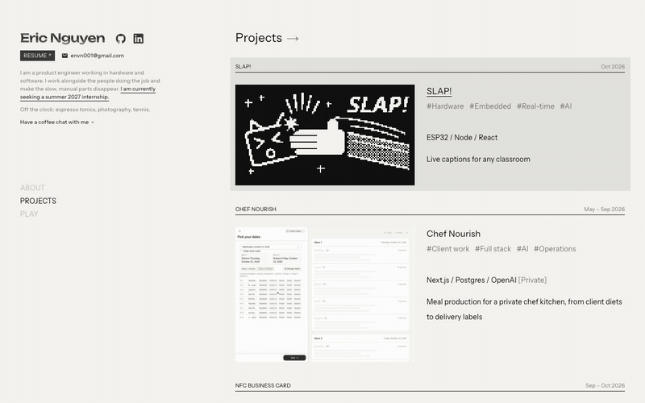
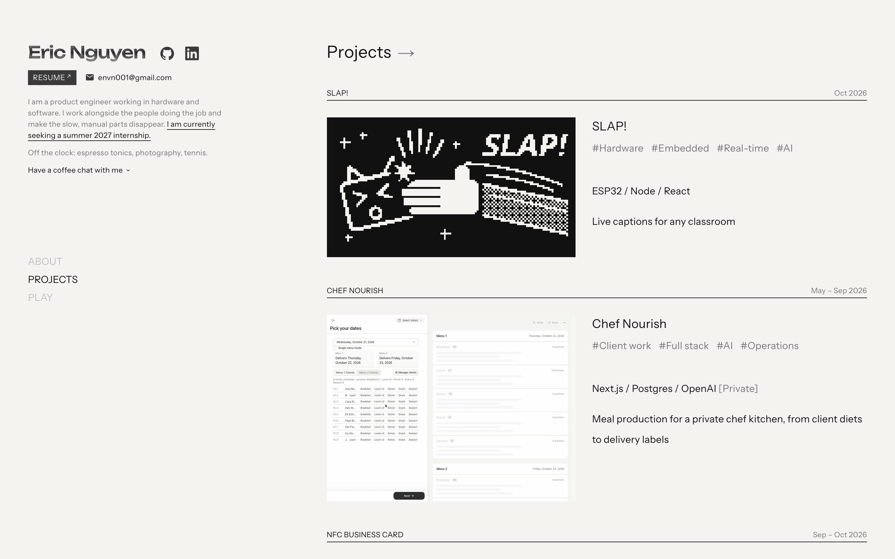
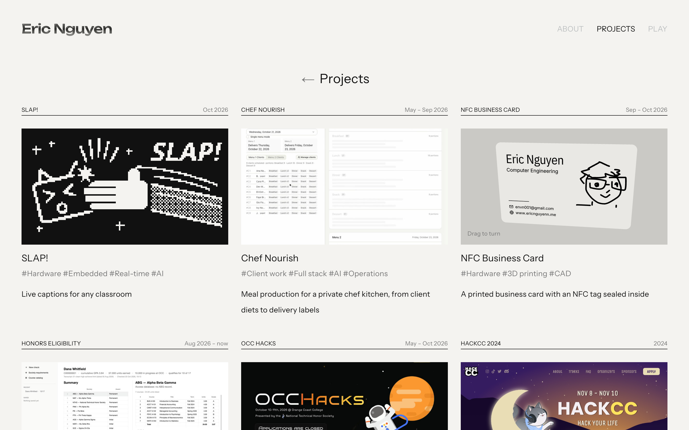
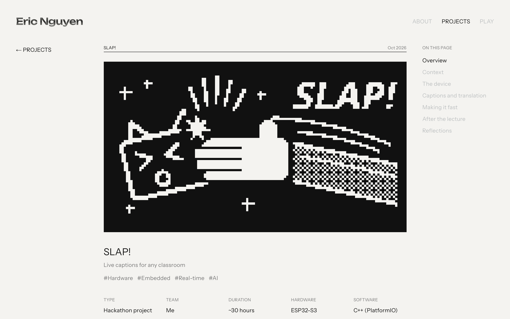
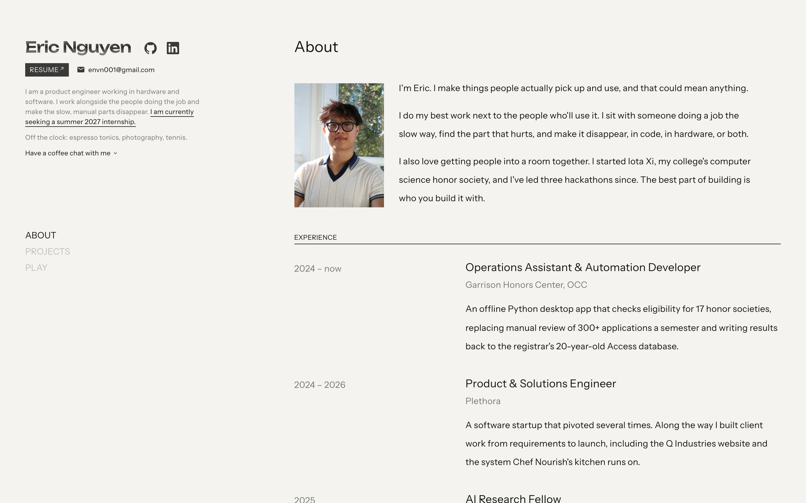
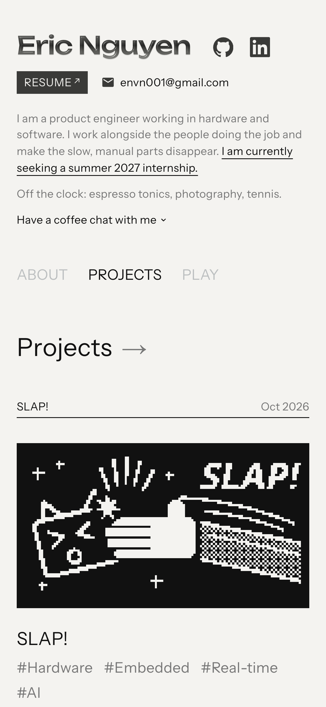
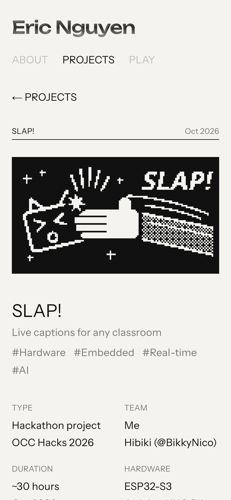
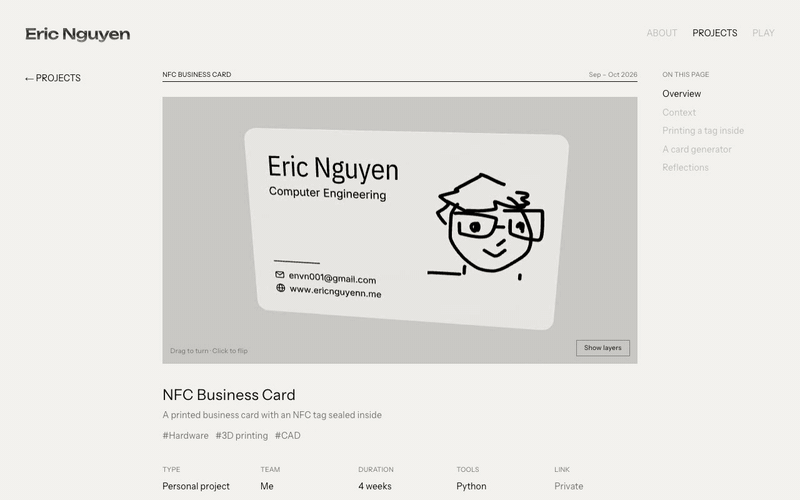
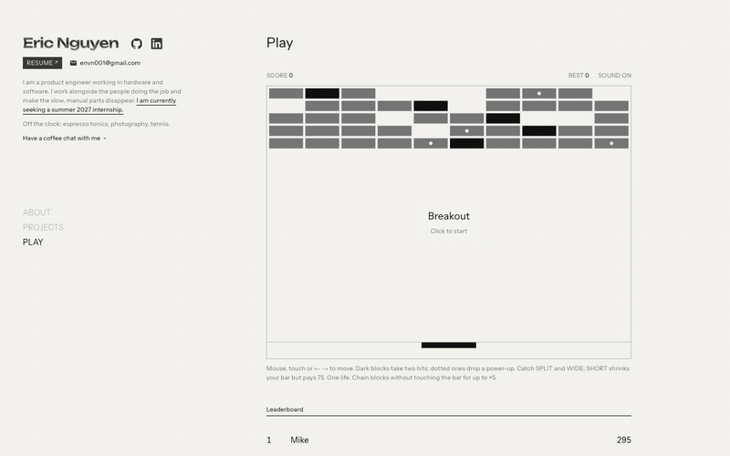
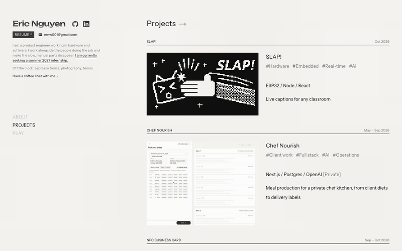

# ericnguyen

Eric Nguyen's portfolio, live at [ericnguyenn.me](https://ericnguyenn.me). Next.js 16, Tailwind 4,
Motion, three.js, one shadcn tooltip.



```bash
npm run dev
```

## Pages

| Route | File | What's there |
| --- | --- | --- |
| `/` | `components/portfolio.tsx` | Sidebar intro, featured projects, the rest as a list |
| `/projects` | `app/(wide)/projects/page.tsx` | Every project as a card grid |
| `/projects/<slug>` | `components/project-detail.tsx` | Write-up with facts strip, figures, video and an on-this-page index |
| `/about` | `app/(site)/about/page.tsx` | Bio and experience, from `lib/about.ts` |
| `/play` | `components/breakout.tsx` | Breakout with a shared leaderboard |
| `/blogs`, `/privacy` | `app/(site)/…` | Posts from `lib/posts.ts`; privacy note |









<table>
  <tr>
    <td></td>
    <td></td>
  </tr>
</table>

## Projects and media

Projects and links live in `lib/projects.ts`; write-ups for `/projects/<slug>` live in
`lib/project-details.ts`. Gifs go in `public/media/<slug>.gif`. Two cards render live instead:

- **SLAP!** plays its device switch-on animation from `lib/slap-splash.ts` (source: `3nvyx/slap` →
  `screen-lab/sprites.js`). It plays once on load and again on hover or click.
- **NFC Business Card** is a three.js model (`components/nfc-card-3d.tsx`). Drag to turn it; on
  the project page, click to flip it, and "Show layers" pulls the print layers apart to show the tag.



Project pages can also embed a 360° video (`components/video-360.tsx`), used for SLAP!'s
soldering footage.

## Breakout

`/play` is a one-life Breakout: tough blocks, power-ups (SPLIT, WIDE, SHORT) and a combo
multiplier for chaining blocks without touching the paddle. Scores go to a Neon Postgres table
through `app/api/leaderboard`. Set `DATABASE_URL` (see `.env.example`); without it the game still
plays and the board hides.



## Coffee chat booking

The sidebar and footer "coffee chat" button opens a dropdown of open 30-minute slots over the
next two weeks (`components/coffee-chat.tsx`, `app/api/coffee-chat/*`). Slots come from the
weekly class schedule in `lib/availability.ts` plus, when Google credentials are set, live
free/busy from both of Eric's calendars. Booking creates the event on the Gmail calendar and
invites the student address, so it lands on both and Google emails the invite. Setup is in
`.env.example`; `node scripts/google-oauth-token.mjs` mints the refresh token.


